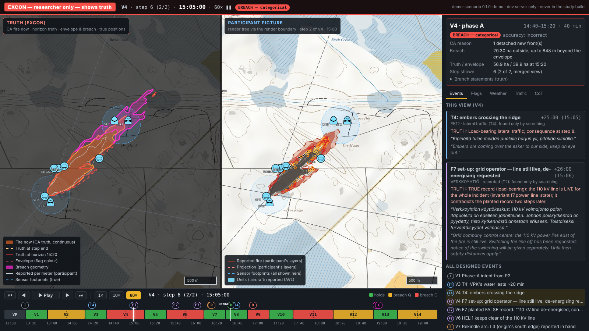

# tak-sim — the TAK-based build of the Fire-rescue-simulation research instrument

> **Public repository — the answer keys are in here.** By the researcher's choice (13 Oct 2026, `SPEC/28_TAK_Base.md` §8)
> this build lives in the public `Test-your-thinking` repository **with the full study content and answer keys**
> (flags, the truth perimeters, freeze-item keys, the designed events). A participant could in principle find them.
> **Before data collection, either make this repository private or move the build to the private
> `Fire-rescue-simulation` repository** (`SPEC/11` §7.22).

This is the research instrument of a doctoral study (Kalle Koivunen, LUT University) on how incident commanders
verify machine-generated projections in wildfire command: one participant at a time runs a scripted wildfire
incident (a practice view and fourteen map views), judges the fire-spread projection, plans, answers situation
questions and may consult an AI assistant. `tak-sim/` is the **TAK-based** version of the
`Fire-rescue-simulation` instrument: the same study, presented and encoded after **Team Awareness Kit** conventions —
a map-centred common operating picture, MIL-STD-2525 unit symbols (milsymbol), GeoChat rooms, a contacts list, drone
video tiles, range & bearing, and a **Cursor on Target (CoT)** stream that real TAK clients (ATAK, WinTAK, iTAK) can
open. It is a clean-room web simulation: no TAK binary, plugin SDK or server is used (`SPEC/28` §1, §7).

**Study design (19 Oct 2026):** [`SPEC/30_Two_Group_Teaming_Design.md`](SPEC/30_Two_Group_Teaming_Design.md) governs the
two groups (Haku 50, the guide 50), the guide's rule-based premise check, the measures and the hypotheses of Papers 1–3,
and the before-pilot checklist (`SPEC/11` §7.30).

**Governing spec:** [`SPEC/28_TAK_Base.md`](SPEC/28_TAK_Base.md) decides how the TAK base looks and is encoded;
[`SPEC/00_README.md`](SPEC/00_README.md) gives the reading order, precedence and the seven invariants. Nothing in the
study design changes with the TAK base: `SPEC/00`–`27` still decide what the participant sees and when.

## Running it

Requires **Node 22**.

```bash
npm ci                     # full install
npm ci --ignore-scripts    # restricted networks: skips install scripts that download binaries
                           # (onnxruntime for the Thinker's embedder); the UI, tests and TAK tools do not need them
```

| Command | What it does |
|---|---|
| `npm run dev` | The participant app on the Vite dev server, http://localhost:5173/. The **TAK shell** is the default screen; `?klassinen` (or `?classic`) gives the classic layout of `SPEC/06`. The shell used is logged in the session header (`uiShell`). |
| `npm run thinker:server` | The Haku / Thinker proxy (`/api/thinker`, `/api/thinker-open`; the dev server proxies to it). Needs `GEMINI_API_KEY` for live answers, otherwise template fallback — see [`docs/DEPLOYMENT.md`](docs/DEPLOYMENT.md). |
| `npm run tak:export` | **TAK interop, outside study runs.** Writes `dist-tak/`: `V00.cot.xml` … `V14.cot.xml`, the timed stream `scenario.cot.jsonl` and the data package `tak-sim-datapackage.zip` for ATAK / WinTAK / iTAK. Byte-identical across runs. |
| `npm run tak:replay -- --host H --port P [--proto tcp\|udp] [--speed N] [--dry-run]` | **TAK interop, outside study runs.** Streams the timed CoT to a TAK Server (TCP 8087) or the SA multicast (UDP 239.2.3.1:6969) so a real TAK client can follow the incident — for demonstrations, reviewers and the domain experts. Never during a session (I3). |
| `npm run excon` | The **researcher-only** exercise-control display, http://localhost:5173/excon.html (dev server only; it **shows truth** — see below). Without a desktop browser `--open` only logs an `xdg-open` error; open the printed URL. |
| `npm run ci` | Type check (strict), the determinism lint and the full test suite — what CI runs. |
| `npm run build:prod` / `npm run serve` | The study build (`dist/ui`) and the production server; see [`docs/DEPLOYMENT.md`](docs/DEPLOYMENT.md). |

CI: `.github/workflows/tak-sim-ci.yml` at the repository root runs `npm ci` and `npm run ci` in `tak-sim/` on every
push and pull request that touches `tak-sim/**`. (The copy under `tak-sim/.github/` is inert in a subfolder.)

## The Thinker's model build (SPEC/30 §10)

Set `THINKER_EXPECTED_MODEL_VERSION` in the Thinker server's environment to the build a probe run reports
(`npm run thinker:probe`, needs `GEMINI_API_KEY`; it prints the build and the table-driven premise statuses).
With it set, an answer from any other build is refused as a model error (the participant sees the ordinary
"unavailable" answer) and logged `modelVersionMismatch`; a build change inside a session is logged
`modelVersionChanged`. Run the probe weekly during data collection and keep its log; a forced change of
build is a treatment revision (SPEC/09 revision (ax)).

## EXCON — the white cell's display (researcher only, shows truth)

`npm run excon` opens the exercise-control page of `SPEC/28` §8, after the researcher's August 2026 white-cell design
(Command: Modern Operations style, "continuous realistic change"). It is a tool for the researcher, reviewers and
demonstrations — **never for participants**.



- **Left — Truth (EXCON):** the cellular-automaton fire, morphing continuously through each 20-minute step; the
  truth at the step's end and at the projection's horizon (`actualPerimeterAtEnd`); the envelope in its flag's colour
  (holds / breach quantitative / breach categorical) with the **breach geometry** highlighted; units and aircraft
  as 2525 symbols at their **true, interpolated** positions; true sensor footprints.
- **Right — Participant picture:** exactly what the participant's map shows (reported perimeter, projection, units,
  aircraft, sensor footprints), derived through the render boundary (`applyRenderEvent` → `toRenderableCycle` /
  `toRenderableEnvelope`) and drawn with the participant's own fire layers. The two maps pan and zoom together.
- **Timeline:** VP (W2) + V1–V14 and their steps, coloured by the true flag, with the designed events (F7 false
  20 kV line record (110 kV before SPEC/33 (bc)), the rekindle arc, the omission at V9, the contradiction at V13, the directive at V8, the hinge);
  play / pause, 1× / 10× / 60× virtual time, step and view jumps (Space, ←/→, Shift+←/→, 1/2/3). Interpolation is
  deterministic: a position always shows the same picture, anchored at every step start to the reported positions.
- **Side panel:** the view's truth card (flag, CA reason, breach area and depth, branch truth), and tabs for the
  designed events, every view's flag, the weather / wind schedule, the participant-visible traffic (pushed count per
  step, the messages) and the view's **CoT** stream (compiled by `app/tak/compile.ts` from the render tree).
- Query parameters for demonstrations: `/excon.html?view=V9&at=600&speed=10&play=1`.

**Isolation (invariant I4).** EXCON lives only in `app/excon/` and is served only by the dev server's
`excon-dev-page` plugin (`vite.config.ts`, `apply: "serve"`; deliberately not a rollup input). Nothing in the
participant bundle imports it, `vite build` / `npm run build:prod` fail if any EXCON module or file reaches the output
(`excon-build-guard`, `tools/deploy/excon-guard.ts`), and the production server answers 404 to any `/excon` path
(`server/production/static.ts`). `test/excon/isolation.spec.ts` checks all of it.

More screenshots: [`docs/screenshots/`](docs/screenshots/) (`excon-v9-flags.png` — the omission view,
`excon-v13-traffic.png` — the contradiction view, `excon-v8-cot.png` — the directive view's CoT,
`excon-v6-weather-playing.png`).

## The invariants

Violating any of these invalidates collected data (`SPEC/00` §3; how the TAK base keeps each: `SPEC/28` §7).

| | Invariant | In short |
|---|---|---|
| I1 | Determinism | Same scenario, seed and inputs ⇒ byte-identical log. No `Date.now()`, `Math.random()`, unordered iteration in logic (`npm run lint:determinism`). CoT export twice = byte-identical. |
| I2 | No wall-clock in logic | Virtual time only; CoT times derive from virtual time (incident day Fri 26 July 2030, UTC+3). |
| I3 | No network during a run | Tiles, scenario and fonts are local; no TAK server during a run; `tak:replay` is offline tooling (Thinker's own proxy is the one exception, `SPEC/00` revision (q)). |
| I4 | Truth never reaches the render layer | Truth is stripped at the render boundary; CoT is compiled from `Renderable*` types only; EXCON, which reads truth, is isolated from the participant bundle. |
| I5 | Crash-safe, gapless logging | Every record durably persisted before the UI acknowledges; TAK tool use is logged through `logMapUse`. |
| I6 | Retrieval closure | Haku returns authored content only; Thinker generates only from what its retrieval returns. |
| I7 | Licence purity | MIT-compatible only (milsymbol, mgrs: MIT); no TAK code, no ATAK-CIV (GPL). |

## Where things are

`app/` — the instrument (`engine/`, `scenario/` incl. truth, `boundary/` the I4 type boundary, `render/` the
participant UI, `session/`, `telemetry/`, `tak/` the CoT model, compiler and TAK symbols, `excon/` the researcher-only
display) · `server/` — Thinker proxy, session-log upload, production server · `tools/` — fire model, maps, corpus,
TAK export / replay, deploy · `test/` — vitest suites · `SPEC/` — the design · `docs/` — deployment and screenshots.

Licence: MIT (`LICENSE`).
